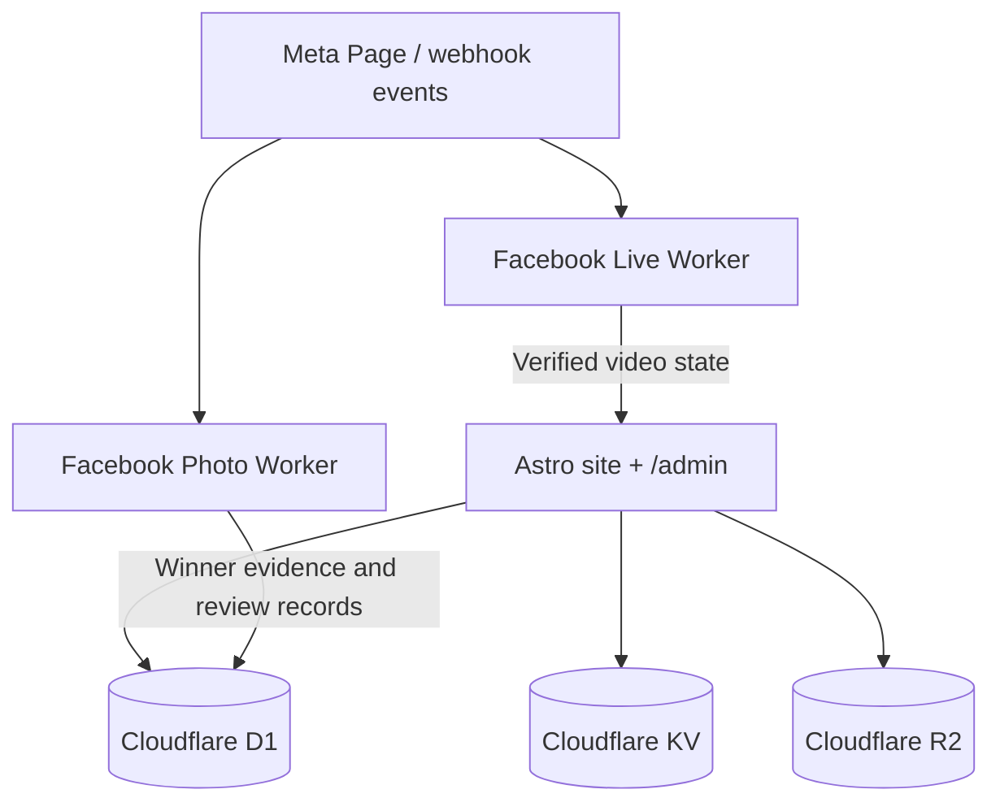
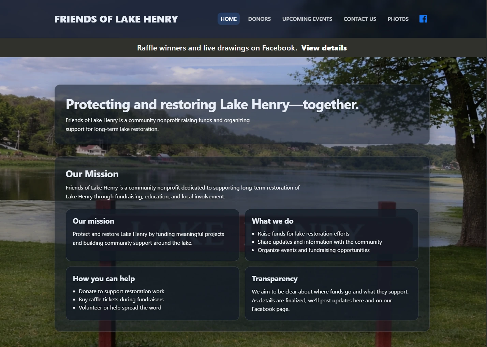
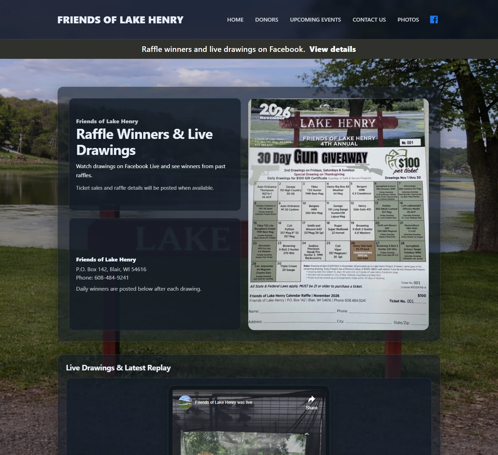
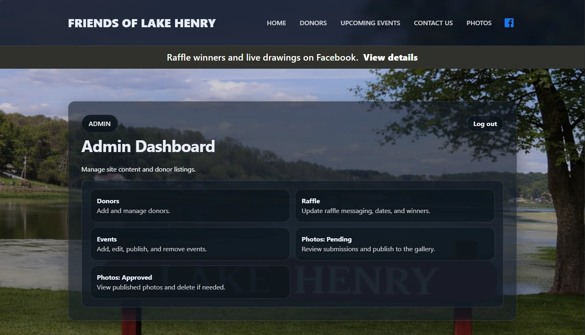
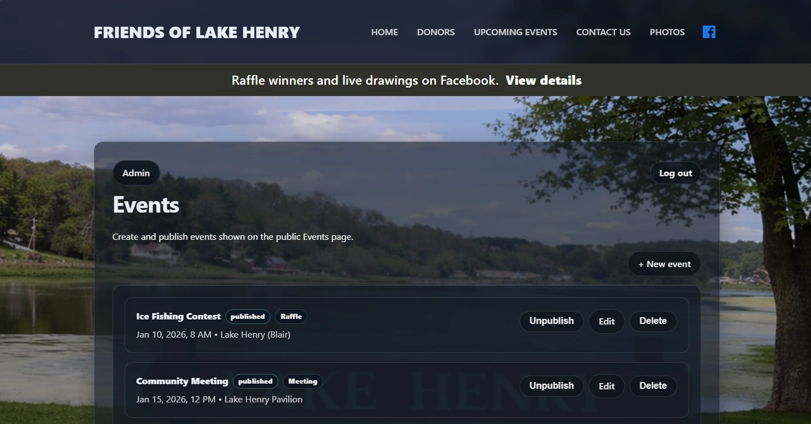
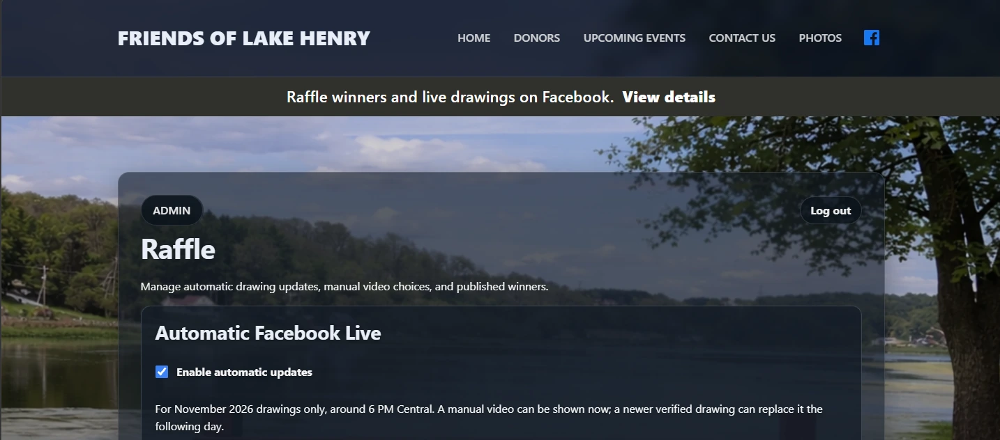
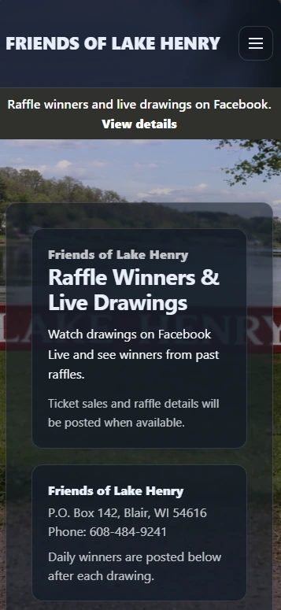

<div align="center">

# 🌊 Friends of Lake Henry

### Community nonprofit platform · Events · Raffles · Facebook automation

[](https://friendsoflakehenry.com)
[](https://astro.build/)
[](https://www.cloudflare.com/)

[](LICENSE)

**[🌐 Live Site](https://friendsoflakehenry.com)** · **[🎟️ Raffle](https://friendsoflakehenry.com/raffle)** · **[GitHub](https://github.com/joshua-werlein/friends-of-lake-henry)** · **[👨‍💻 Developer Portfolio](https://joshuawerlein.com)**

</div>

---

## ✨ Overview

A production website and operational platform for a nonprofit focused on lake restoration and community events. It pairs simple administration for volunteers with **time-sensitive fundraising workflows**: raffle results, prizes, Live video, community photos, and donor recognition.

Volunteers manage drawings and corrections through authenticated tools. The public raffle page shows verified results and the current stream or latest replay.

## 🚀 Features

| Area | What the system supports |
| :--- | :--- |
| 📅 **Events** | Authenticated event editing, scheduling, and poster management. The public Events page is under construction. |
| 💝 **Donors** | Donor recognition and managed public listings |
| 🎟️ **Raffles** | Prize calendar, winner entry/correction, results, history, and season configuration |
| 📺 **Facebook Live** | Dedicated Worker-based discovery, stream/replay presentation, and fallback behavior |
| 📸 **Winner photos** | Automated intake, AI-assisted extraction, evidence checks, and an explicit review path for uncertain rows |
| 🖼️ **Photo gallery** | Upload, categorization, approval, and moderation of community photos |
| 🔐 **Administration** | Protected sessions, server-side mutations, and audit/operational diagnostics |
| 🛟 **Recovery** | Tests, incident records, guarded updates, and staged deployment/rollback documentation |

## 🧩 Architecture



The Astro application provides public pages, server routes, and administration. Dedicated Workers cover event-driven and scheduled Facebook activities. **D1 stores structured records, KV stores configured/session state, and R2 stores image assets.**

## 🔎 Raffle automation

The [Facebook Live Worker](workers/facebook-live/) checks source and timing evidence before updating the displayed video. The raffle page can retain the latest verified replay while a live update awaits confirmation.

The [Facebook Photos Worker](workers/facebook-photos/) queues winner-photo processing. Automatic publication requires verified source and winner evidence. Ambiguous rows enter a review queue where staff can inspect the source or make corrections.

<details>
<summary><strong>Operational safeguards</strong></summary>

Signed webhook intake, scheduled processing, and documented rollback procedures support recovery. See the [automation runbook](docs/facebook-automation-production-2026-11-03.md) and [winner-photo review guide](docs/raffle-photo-autopublish.md).

</details>

### 📌 Hosting and upgrade status

The public service remains on **Astro 5 / Cloudflare Pages**. The nonprofit Cloudflare account migration and Astro 7 transition are still pending. As documented in the migration runbook, the destination still requires storage, secrets/binding parity, and full regression verification. The account move is deferred until after the November 2026 drawing season.

## 📷 Screenshots

### Public site

| Homepage | Raffle on desktop |
| :---: | :---: |
| [](docs/screenshots/homepage.webp) | [](docs/screenshots/raffle-public.webp) |

### Administration

| Dashboard | Event management |
| :---: | :---: |
| [](docs/screenshots/admin-dashboard.webp) | [](docs/screenshots/admin-events.webp) |

### Raffle views

| Raffle administration | Raffle on mobile |
| :---: | :---: |
| [](docs/screenshots/admin-raffle.webp) | [](docs/screenshots/raffle-launch-mobile.webp) |

## 🛠️ Tech stack

**Frontend:** Astro 5 · TypeScript · responsive HTML/CSS  
**Serverless:** Cloudflare Pages + Workers · D1 (SQLite) · KV · R2  
**Integrations:** Meta/Facebook Graph API · webhook intake · AI-assisted photo parsing  
**Quality:** isolated integration tests · TypeScript checks · guarded releases

## 💻 Local development

Use the Node version and engine requirements defined in `.nvmrc` and `package.json`.

```bash
npm install
npm run dev
npm test
npm run typecheck
npm run build
```

Worker-specific builds/typechecks have separate scripts in `package.json`. Tests can use isolated Cloudflare emulation; never substitute test data for production records.

<details>
<summary><strong>📚 Technical documentation and rollout notes</strong></summary>

- [Facebook production automation](docs/facebook-automation-production-2026-11-03.md)
- [Live timing and diagnostics](docs/facebook-live-timing-diagnostics.md)
- [Photo automation and review](docs/raffle-photo-autopublish.md)
- [Two-stage winner-photo extraction](docs/raffle-photo-two-stage-2026-11-12.md)
- [Account migration / cutover safeguards](docs/cloudflare-account-migration-2026-11-08.md)
- [Astro 7 upgrade assessment](docs/astro-7-upgrade-assessment.md)

</details>

## 📜 License and authorship

The project's [LICENSE](LICENSE) is **proprietary**, not MIT. Code and organizational materials are available for portfolio/technical inspection; reuse or redistribution requires permission.

**Developed and maintained by Joshua Werlein** · [Portfolio](https://joshuawerlein.com) · [GitHub](https://github.com/joshua-werlein)
