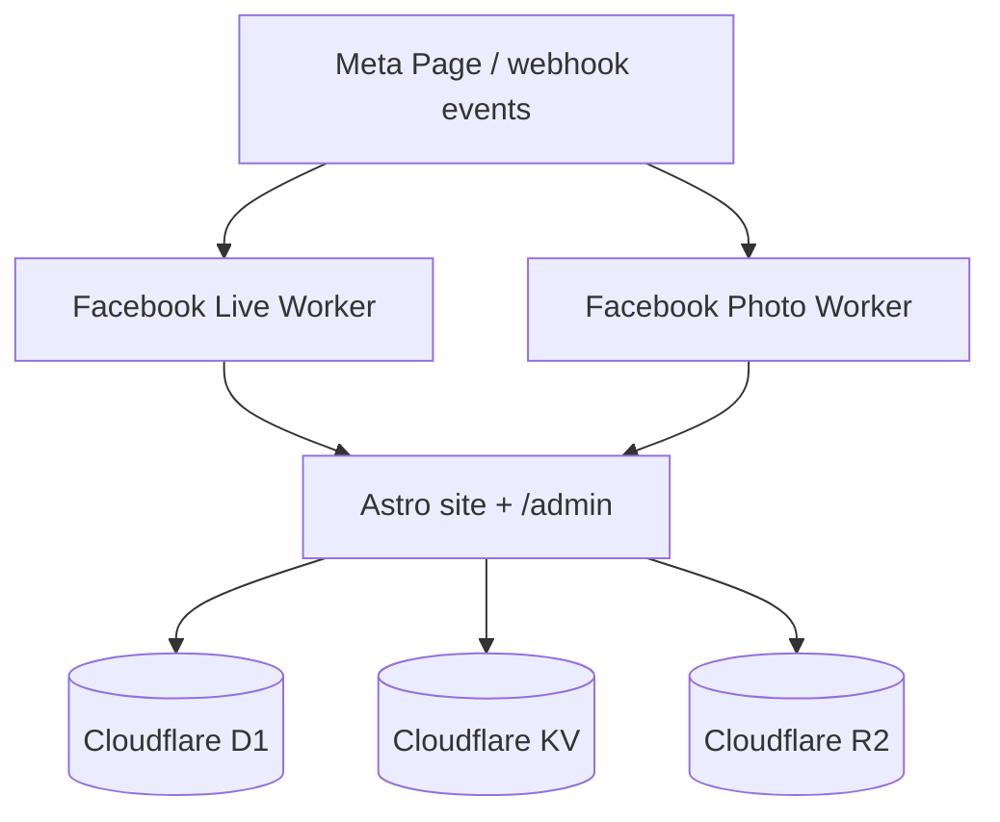

<div align="center">

# 🌊 Friends of Lake Henry

### Community nonprofit platform · Events · Raffles · Facebook automation

[](https://friendsoflakehenry.com)
[](https://astro.build/)
[](https://www.cloudflare.com/)

[](LICENSE)

**[🌐 Live Site](https://friendsoflakehenry.com)** · **[🎟️ Raffle](https://friendsoflakehenry.com/raffle)** · **[👨‍💻 Developer Portfolio](https://joshuawerlein.com)**

</div>

---

## ✨ Overview

A production website and operational platform for a nonprofit focused on lake restoration and community events. It pairs simple administration for volunteers with **time-sensitive fundraising workflows**: raffle results, prizes, Live video, community photos, and donor recognition.

The key engineering requirement is **reliable updates when outside services, timing, or photo evidence are imperfect**—not merely rendering a public website.

## 🚀 Features

| Area | What the system supports |
| :--- | :--- |
| 📅 **Events** | Public events, date and poster management, and authenticated editing |
| 💝 **Donors** | Donor recognition and managed public listings |
| 🎟️ **Raffles** | Prize calendar, winner entry/correction, results, history, and season configuration |
| 📺 **Facebook Live** | Dedicated Worker-based discovery, stream/replay presentation, and fallback behavior |
| 📸 **Winner photos** | Automated intake, AI-assisted extraction, evidence checks, and an explicit review path for uncertain rows |
| 🖼️ **Photo gallery** | Upload, categorization, approval, and moderation of community photos |
| 🔐 **Administration** | Protected sessions, server-side mutations, and audit/operational diagnostics |
| 🛟 **Recovery** | Tests, incident records, guarded updates, and staged deployment/rollback documentation |

## 🧩 Architecture



The Astro application provides public pages, server routes, and administration. Dedicated Workers cover event-driven and scheduled Facebook activities. **D1 stores structured records, KV stores configured/session state, and R2 stores image assets.**

## 🔎 Engineering highlights

### ⚡ Time-sensitive Live and raffle behavior

The public raffle view needs to display correct winners and video state around scheduled drawing windows. Worker integrations, cache/fallback behavior, and diagnostic records help distinguish a delayed outside service from a confirmed update.

### 🤖 Human-reviewed photo automation

Winner images are processed through structured extraction and evidence validation. Ambiguous rows can be **held for review rather than automatically published as facts**. Source records and correction workflows support later reconciliation.

### 🛡️ Controlled change and recovery

The system uses versioned database changes, tests, operational records, and rollback planning. Production changes and hosting cutover are deliberately separated from routine raffle operation.

### 📌 Hosting and upgrade status

The public service remains on **Astro 5 / Cloudflare Pages**. A separate Cloudflare nonprofit-account migration and Astro 7 transition are **not completed production cutovers**. As documented in the migration runbook, the destination still requires storage, secrets/binding parity, and full regression verification. The account move is deferred until after the November 2026 drawing season.

## 📷 Screenshots

| Homepage | Events |
| :---: | :---: |
|  |  |

| Raffle | Admin dashboard |
| :---: | :---: |
|  |  |

## 🛠️ Tech stack

**Frontend:** Astro 5 · TypeScript · responsive HTML/CSS  
**Serverless:** Cloudflare Pages + Workers · D1 (SQLite) · KV · R2  
**Integrations:** Meta/Facebook Graph API · webhook intake · AI-assisted photo parsing  
**Quality:** isolated integration tests · TypeScript checks · guarded releases

## 💻 Local development

Use the Node version and engine requirements defined in `.nvmrc` and `package.json`.

```bash
npm install
npm run dev
npm test
npm run typecheck
npm run build
```

Worker-specific builds/typechecks have separate scripts in `package.json`. Tests can use isolated Cloudflare emulation; never substitute test data for production records.

<details>
<summary><strong>📚 Technical documentation and rollout notes</strong></summary>

- [Facebook production automation](docs/facebook-automation-production-2026-11-03.md)
- [Live timing and diagnostics](docs/facebook-live-timing-diagnostics.md)
- [Photo automation and review](docs/raffle-photo-autopublish.md)
- [Two-stage winner-photo extraction](docs/raffle-photo-two-stage-2026-11-12.md)
- [Account migration / cutover safeguards](docs/cloudflare-account-migration-2026-11-08.md)
- [Astro 7 upgrade assessment](docs/astro-7-upgrade-assessment.md)

</details>

## 📜 License and authorship

The project's [LICENSE](LICENSE) is **proprietary**, not MIT. Code and organizational materials are available for portfolio/technical inspection; reuse or redistribution requires permission.

**Developed and maintained by Joshua Werlein** · [Portfolio](https://joshuawerlein.com) · [GitHub](https://github.com/joshua-werlein)
